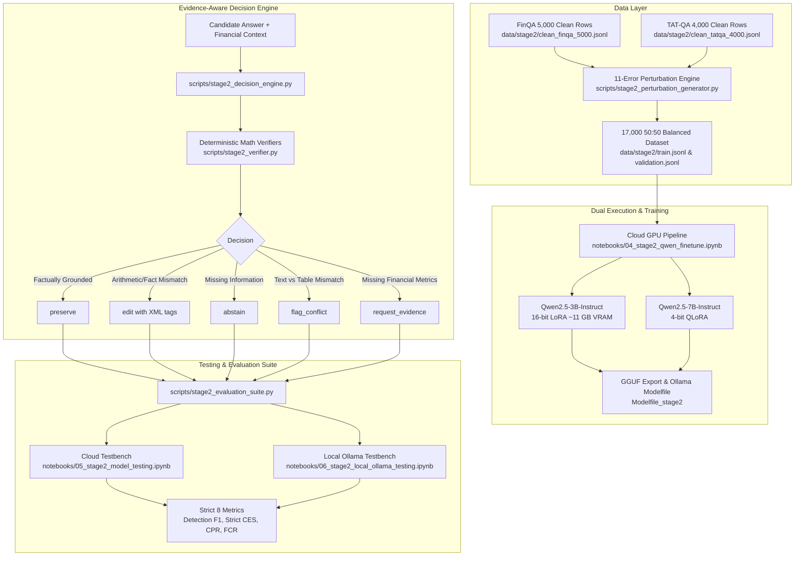

# FRED — Financial Retrieval-Enhanced Detection & Selective Editing of Hallucinations

[](https://www.python.org/)
[](#-stage-1-replicated-results--evaluation)
[](#-stage-2-evidence-aware-selective-editing-engine)
[](https://huggingface.co/Akash-Purbhi)
[](https://github.com/unslothai/unsloth)
[](https://ollama.com/)
[](#-stage-2-architecture--decision-engine)
[](#-stage-2-strict-evaluation-methodology)

> **Repository status (updated 2026-11-04):** Source code, notebooks, reports, and configuration files are tracked here. Generated Stage 2 datasets are intentionally ignored by Git, and model weights/checkpoints are intentionally excluded from this repository. Fine-tuned Stage 2 models are available from the [Akash-Purbhi Hugging Face profile](https://huggingface.co/Akash-Purbhi).

> **FRED** (**F**inancial **R**etrieval-**E**nhanced **D**etection and **E**diting) is an enterprise-grade framework designed to detect, reason over, verify, and surgically correct numerical and factual hallucinations in financial question-answering systems.
>
> Operating over complex financial tables and narrative disclosures (such as corporate 10-Ks, earnings statements, and SEC filings from **FinQA** and **TAT-QA**), FRED combines **deterministic arithmetic verification** with **LLM selective editing**:
> 1. **Stage 1 (Paper Replication)**: Replicated Tan et al. (*ICML 2025 Workshop / arXiv:2507.20930*) using in-place XML tags (`<numerical><delete>...</delete><mark>...</mark></numerical>`) across 5,997 hybrid samples on Qwen2.5-7B, establishing 46.9% CES and 84.5 Numerical F1.
> 2. **Stage 2 (Evidence-Aware Selective Verification Engine)**: Solved the Stage 1 false-correction deficit (40.5% CPR) by engineering an **evidence-aware 5-action decision engine** (`preserve`, `edit`, `abstain`, `flag_conflict`, `request_evidence`), expanding to **17,000 strictly 50:50 balanced training samples** across **11 financial error types**, integrating **deterministic Python math verifiers**, and providing both **cloud GPU fine-tuning (Kaggle/Colab)** and **100% private offline local inference via Ollama**.

---

## 📑 Table of Contents

- [🎓 Academic Replication & Background](#-academic-replication--background)
- [⚡ Stage 2: Evidence-Aware Selective Editing Engine](#-stage-2-evidence-aware-selective-editing-engine)
  - [1. Motivation: Solving Stage 1 Over-Editing](#1-motivation-solving-stage-1-over-editing)
  - [2. The 5-Action Decision Taxonomy](#2-the-5-action-decision-taxonomy)
  - [3. 11 Fine-Grained Financial Error Types](#3-11-fine-grained-financial-error-types)
  - [4. 17,000-Sample Balanced Dataset](#4-17000-sample-balanced-dataset)
  - [5. Deterministic Verifier & Decision Engine](#5-deterministic-verifier--decision-engine)
  - [6. Strict 8-Metric Evaluation Suite](#6-strict-8-metric-evaluation-suite)
- [🧠 System Architecture](#-system-architecture)
- [📁 Repository Structure](#-repository-structure)
- [🛠️ Quickstart Guide](#-quickstart-guide)
  - [Stage 2 End-to-End Pipeline (Recommended)](#stage-2-end-to-end-pipeline-recommended)
  - [Stage 1 Historical Replication](#stage-1-historical-replication)
- [📊 Milestone Tracker](#-milestone-tracker)
- [📈 Stage 1 Replicated Results & Evaluation](#-stage-1-replicated-results--evaluation)
  - [Table 1 Replication: Error Distribution](#1️⃣-table-1-replication-error-distribution-in-training-data)
  - [Table 3 Replication: Detection F1 & In-Place Editing](#2️⃣-table-3-replication-detection-performance-f1-score--in-place-editing)
  - [Table 5 Replication: LLM-as-a-Judge FActScoreLite](#3️⃣-table-5-replication-factual-accuracy-via-llm-as-a-judge-factscorelite)
  - [Table 11 & 12 Replication: Precision and Recall Diagnostics](#4️⃣-table-11--table-12-replication-precision-and-recall-diagnostics)
- [📜 Acknowledgements & Citation](#-acknowledgements--citation)

---

## 🎓 Academic Replication & Background

This project began as a faithful academic replication of:
- **Title**: *FRED: Financial Retrieval-Enhanced Detection and Editing of Hallucinations in Language Models*
- **Authors**: Likun Tan\*, Kuan-Wei Huang\*, Kevin Wu (University of Michigan / Pegasi AI)
- **Publication**: ICML 2025 Workshop on Assessing World Models ([arXiv:2507.20930](https://arxiv.org/abs/2507.20930), July 2025)
- **Local PDF Reference**: [`LLM FRED.pdf`](./LLM%20FRED.pdf)

### Replication vs. Original Paper: Design Adaptations

| Aspect | Original Paper | Stage 1 (Replication) | Stage 2 (Our Evidence-Aware Extension) |
|---|---|---|---|
| **Goal & Scope** | Enterprise-scale broad hallucination editing | Replicate quantitative financial editing on consumer hardware | 5-way evidence-aware verification, math calculation validation, strict span CES, and dual cloud/offline local deployment |
| **Compute Environment** | Multi-GPU cluster (A100/H100) | Single-GPU Kaggle/Colab T4 (Unsloth QLoRA) | Free-tier Kaggle/Colab T4 (3B 16-bit LoRA + 7B 4-bit QLoRA) & local offline Ollama workstation |
| **Base Models** | Phi-4, Phi-4-mini, Qwen3-4B/14B | Qwen2.5-7B-Instruct | **Qwen2.5-3B-Instruct (16-bit)**, **Qwen3-4B (LoRA)** & **Qwen2.5-7B-Instruct (4-bit QLoRA)** |
| **Dataset Scale** | ~36,000 multi-dataset corpus | 5,997 samples (~20% clean) | **17,000 balanced samples (strictly 50% clean : 50% corrupted)** |
| **Clean Control Ratio** | Unspecified / Implicit | ~20.8% (1,250 clean) $\rightarrow$ caused 59.5% FCR | **50.0% clean** (8,500 clean / 8,500 corrupted in Train; 500/500 in Val) |
| **Actions** | Binary edit (`<numerical>`, `<temporal>`) | Binary edit (`<numerical>`, `<temporal>`) | **5 Actions**: `preserve`, `edit`, `abstain`, `flag_conflict`, `request_evidence` |
| **Error Taxonomy** | 6 broad domains | 2 categories (numerical, temporal) | **11 fine-grained financial error types** |
| **Verification Logic** | LLM internal generation only | LLM internal generation only | **Hybrid deterministic math verifier** + candidate number extraction + LLM controller |
| **Evaluation Metrics** | Detection F1, FActScoreLite | Detection F1, naive XML presence CES, LLM Judge | **8 strict metrics**: Detection F1, CPR, FCR, **Strict Span-Matching CES**, Abstention F1, Conflict F1, Evidence accuracy, Risk-Coverage Curve |
| **Deployment** | Server API endpoints | Local Ollama (`Modelfile`) | Dual: Cloud GPU Testbench (`notebooks/05_stage2_model_testing.ipynb`) & Local Offline Ollama (`Modelfile_stage2`, `scripts/17_run_local_ollama.py`) |

---

## ⚡ Stage 2: Evidence-Aware Selective Editing Engine

### 1. Motivation: Solving Stage 1 Over-Editing
In Stage 1, while our fine-tuned Qwen 7B model achieved an impressive **91.2 Binary F1** and **46.9% CES** (a 5.9× jump over base models), the diagnostic evaluation revealed a critical vulnerability:
- **Clean Preservation Rate (CPR)** was only **40.5%**, meaning **59.5% of clean answers were incorrectly modified** (False Correction Rate).
- The model operated as an over-eager editor because only ~20% of the Stage 1 training corpus was clean.
- In financial audits, modifying a correct number is just as dangerous as failing to catch an erroneous one.
- Furthermore, binary editing forced the model to attempt edits even when source disclosures were missing, contradictory, or unanswerable.

### 2. The 5-Action Decision Taxonomy
Stage 2 introduces a 5-way decision policy:
1. `preserve`: The candidate answer is factually grounded in the retrieved table/text and mathematically verified. Output the answer untouched.
2. `edit`: An explicit factual or mathematical discrepancy is detected. The model produces an in-place semantic tag correction: `<category><delete>erroneous_span</delete><mark>verified_span</mark></category>`.
3. `abstain`: The context does not contain sufficient facts to answer the question, or the claim is fundamentally unanswerable without fabricating assumptions.
4. `flag_conflict`: Conflicting data points exist between different sections of the retrieved context (e.g. 10-K footnote says \$450M while the primary balance sheet reports \$485M).
5. `request_evidence`: The retrieved context is irrelevant to the question; request better or more targeted evidence.

### 3. 11 Fine-Grained Financial Error Types
Stage 2 expands from the original numerical/temporal scope to 11 schema categories defined in [`scripts/stage2_schema.py`](./scripts/stage2_schema.py):

| Error Type | Financial Example | Correct Action |
|---|---|:---:|
| `numerical_substitution` | A reported value is replaced with an incorrect value | `edit` |
| `temporal_swap` | A value is attributed to the wrong reporting period | `edit` |
| `arithmetic_miscalculation` | A derived percentage, ratio, or total is calculated incorrectly | `edit` |
| `wrong_unit` | Millions, billions, percentages, or other units are confused | `edit` |
| `entity_swap` | A value is attributed to the wrong company or entity | `edit` |
| `relation_inversion` | A financial relationship or formula is inverted | `edit` |
| `unsupported_claim` | The response asserts information not supported by the evidence | `abstain` |
| `missing_evidence` | Required evidence is not present in the retrieved context | `abstain` |
| `irrelevant_retrieval` | Retrieved context does not answer the question | `request_evidence` |
| `contradictory_context` | Retrieved sources contain conflicting figures or statements | `flag_conflict` |
| `none` | No error; the response is grounded and should be preserved | `preserve` |

### 4. 17,000-Sample Balanced Dataset
To reduce over-editing, the Stage 2 generator creates a strict **50:50 ratio of clean to corrupted records**. The generated files are intentionally excluded by `.gitignore` because they are large and reproducible:
- **Train Split**: 17,000 records (8,500 clean + 8,500 corrupted; 64.9 MB) $\rightarrow$ `data/stage2/train.jsonl` and `train_chatml.jsonl`
- **Validation Split**: 1,000 records (500 clean + 500 corrupted; 3.8 MB) $\rightarrow$ `data/stage2/validation.jsonl` and `validation_chatml.jsonl`
- **Clean Official Test**: 1,200 untouched official FinQA/TAT-QA records $\rightarrow$ `data/stage2/test_clean.jsonl`
- **Corrupted Test Benchmark**: 1,200 controlled hallucination variants $\rightarrow$ `data/stage2/test_corrupted.jsonl`

### 5. Deterministic Verifier & Decision Engine
Rather than relying purely on LLM token probabilities, FRED Stage 2 implements an **evidence-aware decision engine** ([`scripts/stage2_decision_engine.py`](./scripts/stage2_decision_engine.py)) coupled with deterministic Python math validation ([`scripts/stage2_verifier.py`](./scripts/stage2_verifier.py)):
- `verify_margin(net_income, revenue)`: Verifies margin calculations within a strict 0.5% tolerance.
- `verify_growth_rate(prior, current)`: Validates period-over-period percentage growth.
- `verify_ratio(numerator, denominator)`: Validates liquidity, leverage, and valuation ratios.
- `verify_unit_conversion(val, from_unit, to_unit)`: Audits millions vs. billions scaling.
- **Candidate Number Extraction**: Actively parses all numerical entities in candidate answers, cross-references them against 2D tabular grids and narrative sentences, detects mismatches, and prevents erroneous fall-through to `preserve`.

### 6. Strict 8-Metric Evaluation Suite
Stage 2 replaces naive substring checks with comprehensive evaluation criteria ([`scripts/stage2_evaluation_suite.py`](./scripts/stage2_evaluation_suite.py)):
1. **Hallucination Detection Precision, Recall, and F1**: Binary discriminative capability.
2. **Strict Complete Edit Success (CES)**:
   - Must output valid XML syntax (`<category><delete>...</delete><mark>...</mark></category>`).
   - Must match the target error category.
   - The `<delete>` span must match the exact hallucinated span in the text.
   - The `<mark>` span must match the ground truth verified value within 0.5% relative financial tolerance.
3. **Clean Preservation Rate (CPR)**: % of clean records correctly identified as `preserve` without unwanted edits.
4. **False Correction Rate (FCR)**: $1 - \text{CPR}$; proportion of clean passages needlessly corrupted by the model.
5. **Abstention Accuracy**: F1 score on detecting unanswerable and fabricated claims.
6. **Conflict Detection Accuracy**: F1 score on flagging contradictory table/text disclosures.
7. **Evidence Support Accuracy**: Precision of cited document indices against gold evidence.
8. **Risk-Coverage Curve**: Trade-off analysis measuring accuracy when allowing the system to abstain under low confidence.

---

## 🧠 System Architecture



---

## 📁 Repository Structure

```text
FRED/
├── README.md                          # Main project documentation
├── requirements.txt                   # Environment dependencies
├── config.py                          # Global configuration parameters
├── LLM FRED.pdf                       # Reference paper (Tan et al., 2025)
├── Modelfile                          # Stage 1 Ollama model configuration
├── Modelfile_stage2                   # Stage 2 Evidence-Aware Ollama model configuration
│                                      # (requires a local GGUF referenced by the file)
│
├── notebooks/
│   ├── 01_inspect_datasets.ipynb      # Stage 1 data exploration
│   ├── 02_error_insertion_finqa.ipynb # Stage 1 error insertion prototyping
│   ├── 03_kaggle_unsloth_finetune.ipynb # Stage 1 Kaggle QLoRA fine-tuning
│   ├── 04_stage2_qwen_finetune.ipynb  # Stage 2 Qwen 3B (16-bit LoRA) & 7B (4-bit QLoRA)
│   ├── 05_stage2_model_testing.ipynb  # Stage 2 Cloud GPU benchmark (Strict CES)
│   └── 06_stage2_local_ollama_testing.ipynb # Stage 2 Private offline Ollama testing
│
├── scripts/
│   ├── stage2_schema.py               # 12-field unified schema & ChatML formatting
│   ├── stage2_verifier.py             # Deterministic financial math calculations
│   ├── stage2_converter.py            # Deduplicated FinQA & TAT-QA ingestion
│   ├── stage2_perturbation_generator.py # 11-error perturbation generator
│   ├── 16_build_stage2_dataset.py     # 17,000 balanced dataset builder
│   ├── stage2_decision_engine.py      # Evidence-aware 5-action decision controller
│   ├── stage2_evaluation_suite.py     # Strict 8-metric benchmark evaluator
│   ├── 17_run_local_ollama.py         # Local Ollama CLI test runner
│   │
│   ├── 04_transform_chatml.py         # [Stage 1] ChatML formatter
│   ├── 05_generate_cot_dataset.py     # [Stage 1] Bulk CoT generator
│   ├── 06_transform_cot_chatml.py     # [Stage 1] CoT ChatML formatter
│   ├── 07_generate_supplemental_dataset.py # [Stage 1] Clean extraction
│   ├── 08_run_bulk_generation.py      # [Stage 1] Batch generation script
│   ├── 09_audit_high_confidence_canonical.py # [Stage 1] 5-point auditor
│   ├── 10_build_hybrid_dataset.py     # [Stage 1] 5,997 dataset builder
│   ├── 11_validate_hybrid_dataset.py  # [Stage 1] Sanity validation
│   ├── 12_run_evaluation.py           # [Stage 1] Inference runner
│   ├── 13_score_evaluation.py         # [Stage 1] Evaluation scorer
│   ├── 14_llm_judge.py                # [Stage 1] Gemini 3.1 Flash LLM judge
│   └── 15_score_llm_judge.py          # [Stage 1] Table 5 FActScoreLite scorer
│
├── data/
│   ├── final/                         # [Stage 1] tracked 5,997-row dataset
│   └── eval/                          # [Stage 1] Evaluation predictions and judge scores
│
└── reports/
    ├── stage2_dataset_report.md       # Stage 2 split statistics & distributions
    ├── evaluation_report.md           # Stage 1 benchmark report (Tables 3, 5, 11, 12)
    ├── final_dataset_report.md        # Stage 1 dataset composition report
    ├── project_log.md                 # Engineering development timeline
    └── high_confidence_canonical_report.md # Stage 1 audit methodology
```

`data/stage2/` is generated locally by `scripts/16_build_stage2_dataset.py` and is
ignored by Git. GGUF files, adapters, and checkpoints are also ignored; download
the desired fine-tuned model from Hugging Face or provide a local Ollama-compatible
GGUF before using the Modelfiles.

---

## 🛠️ Quickstart Guide

### Stage 2 End-to-End Pipeline (Recommended)

#### 1. Environment Setup
```bash
git clone https://github.com/Akash-Purbhi/FRED-Financial-Retrieval-Enhanced-Detection-and-Editing-of-Hallucinations-in-Language-Models.git
cd FRED
pip install -r requirements.txt
```

#### 2. Build the 17,000 Balanced Stage 2 Dataset
Run the automated ingestion, perturbation generation, and dataset split builder:
```bash
python scripts/16_build_stage2_dataset.py
```
The generated `data/stage2/` files are local build artifacts and are not committed.
The builder also expects the required FinQA/RagBench source data to be available
locally; do not commit external benchmark caches.
This produces:
- `data/stage2/train_chatml.jsonl` (17,000 records, 50% clean : 50% corrupted)
- `data/stage2/validation_chatml.jsonl` (1,000 records)
- `data/stage2/test_clean.jsonl` (1,200 official clean records)
- `data/stage2/test_corrupted.jsonl` (1,200 corrupted benchmark records)

#### 3. Cloud GPU Fine-Tuning (Kaggle or Google Colab)
Open [`notebooks/04_stage2_qwen_finetune.ipynb`](./notebooks/04_stage2_qwen_finetune.ipynb) on Kaggle or Colab (free T4 GPU).
Sequentially trains, evaluates, and exports each model directly to the Hugging Face Hub:
1. **Qwen2.5-3B-Instruct** (16-bit LoRA, 0 quantization precision loss) $\rightarrow$ [`Akash-Purbhi/fredphase2-qwen2.5-3b`](https://huggingface.co/Akash-Purbhi/fredphase2-qwen2.5-3b)
2. **Qwen3-4B** (Paper's core 4B benchmark replication, 16-bit LoRA) $\rightarrow$ [`Akash-Purbhi/fredphase2-qwen3-4b`](https://huggingface.co/Akash-Purbhi/fredphase2-qwen3-4b)
3. **Qwen2.5-7B-Instruct** (4-bit QLoRA, ~9.5 GB VRAM) $\rightarrow$ [`Akash-Purbhi/fredphase2-qwen2.5-7b-lora`](https://huggingface.co/Akash-Purbhi/fredphase2-qwen2.5-7b-lora)

Each stage automatically exports GGUF weights (`q4_k_m`) and publishes the model card.

#### 4. Cloud Model Testing Bench
Run [`notebooks/05_stage2_model_testing.ipynb`](./notebooks/05_stage2_model_testing.ipynb) to test the fine-tuned checkpoint against Base Qwen and commercial LLMs using our strict 8-metric evaluator with span-level exact matching.

#### 5. Local Offline Inference with Ollama
For confidential financial data that cannot leave your local machine:
Download or export a compatible GGUF model first, then update the `FROM` path in
`Modelfile_stage2` if your filename differs. The GGUF weights are intentionally
not stored in this repository.

```bash
# Register Stage 2 model with Ollama
ollama create fred_stage2 -f Modelfile_stage2

# Run local CLI evaluation script
python scripts/17_run_local_ollama.py --model fred_stage2:latest --samples 100

# Or run the interactive notebook
# Open notebooks/06_stage2_local_ollama_testing.ipynb
```

---

### Stage 1 Historical Replication

To reproduce our historical Stage 1 baseline experiments:

```bash
# 1. Build Stage 1 5,997 hybrid dataset
python scripts/10_build_hybrid_dataset.py

# 2. Run local Ollama inference on 841 test records
python scripts/12_run_evaluation.py

# 3. Score evaluation (Tables 3, 11, 12)
python scripts/13_score_evaluation.py

# 4. Run Gemini 3.1 Flash LLM-as-a-judge (Table 5 FActScoreLite)
python scripts/14_llm_judge.py
python scripts/15_score_llm_judge.py
```

---

## 📊 Milestone Tracker

| # | Milestone | Scope | Status | Artifact / Link |
|---|---|:---:|:---:|---|
| 1 | Load & inspect FinQA + TAT-QA | Stage 1 | ✅ Done | [`notebooks/01_inspect_datasets.ipynb`](./notebooks/01_inspect_datasets.ipynb) |
| 2 | Prototype error insertion & tagging | Stage 1 | ✅ Done | [`notebooks/02_error_insertion_finqa.ipynb`](./notebooks/02_error_insertion_finqa.ipynb) |
| 3 | Build 5,997-row hybrid dataset | Stage 1 | ✅ Done | [`data/final/`](./data/final/) |
| 4 | Quality audit & canonical validation | Stage 1 | ✅ Done | [`scripts/09_audit_high_confidence_canonical.py`](./scripts/09_audit_high_confidence_canonical.py) |
| 5 | QLoRA fine-tuning (Qwen2.5-7B, 3 epochs) | Stage 1 | ✅ Done | [`notebooks/03_kaggle_unsloth_finetune.ipynb`](./notebooks/03_kaggle_unsloth_finetune.ipynb) |
| 6 | GGUF quantization & Ollama deployment | Stage 1 | ✅ Done | [`Modelfile`](./Modelfile) |
| 7 | Evaluation: fred vs base Qwen2.5-7B | Stage 1 | ✅ Done | [`reports/evaluation_report.md`](./reports/evaluation_report.md) |
| 8 | LLM-as-a-Judge Evaluation (Table 5) | Stage 1 | ✅ Done | [`data/eval/judge_scores.json`](./data/eval/judge_scores.json) |
| 9 | Unified 12-field schema & ChatML engine | Stage 2 | ✅ Done | [`scripts/stage2_schema.py`](./scripts/stage2_schema.py) |
| 10 | Deterministic arithmetic verifiers | Stage 2 | ✅ Done | [`scripts/stage2_verifier.py`](./scripts/stage2_verifier.py) |
| 11 | 11-category perturbation generator | Stage 2 | ✅ Done | [`scripts/stage2_perturbation_generator.py`](./scripts/stage2_perturbation_generator.py) |
| 12 | Build 17,000 balanced 50:50 dataset | Stage 2 | ✅ Done | [`scripts/16_build_stage2_dataset.py`](./scripts/16_build_stage2_dataset.py) |
| 13 | Evidence-aware decision engine | Stage 2 | ✅ Done | [`scripts/stage2_decision_engine.py`](./scripts/stage2_decision_engine.py) |
| 14 | Strict 8-metric evaluation suite | Stage 2 | ✅ Done | [`scripts/stage2_evaluation_suite.py`](./scripts/stage2_evaluation_suite.py) |
| 15 | Qwen 3B/7B fine-tuning & test notebooks | Stage 2 | ✅ Done | [`notebooks/04_stage2_qwen_finetune.ipynb`](./notebooks/04_stage2_qwen_finetune.ipynb), [`05`](./notebooks/05_stage2_model_testing.ipynb), [`06`](./notebooks/06_stage2_local_ollama_testing.ipynb) |

---

## 📈 Stage 1 Replicated Results & Evaluation

The Stage 1 evaluation tested 841 held-out test records (651 corrupted with numerical/temporal errors, 190 clean). Below is the head-to-head comparison between **Base Qwen2.5-7B** (few-shot prompted using the paper's Appendix E.2 template with error definitions & 1-shot demonstration) and our **FRED-Qwen2.5-7B** (fine-tuned):

| Metric | Base Model (Qwen2.5-7B Few-Shot)* | FRED Model (Fine-Tuned Ours) | Δ Advantage |
|---|:---:|:---:|:---:|
| **Binary Detection F1** | 82.2 | **91.2** | <font color="#10b981">+9.0</font> |
| **Numerical F1** | 76.7 | **84.5** | <font color="#10b981">+7.8</font> |
| **Temporal F1** | 15.9 | **64.7** | <font color="#10b981">**+48.8 (4.1× higher)**</font> |
| **Overall F1** | 71.1 | **81.6** | <font color="#10b981">+10.5</font> |
| **XML Validity Rate** | 55.0% | **97.0%** | <font color="#10b981">+42.0%</font> |
| **CES** (Correction Exact Match) | 7.9% | **46.9%** | <font color="#10b981">**+39.0% (5.9× higher)**</font> |
| **Clean Preservation** | 35.4% | **40.5%** | +5.1% |

*\* Base model evaluated on 435 test records using the exact Appendix E.2 few-shot prompt from the paper. On the identical matched 435-record slice, FRED scores: 91.8 Binary F1, 85.5 Numerical F1, 66.0 Temporal F1, 82.7 Overall F1, and 46.9% CES.*

---

### 1️⃣ Table 1 Replication: Error Distribution in Training Data

| Dimension | Original Paper (FRED Corpus) | Our Stage 1 Dataset | Our Stage 2 Dataset | Design Evolution |
|---|:---:|:---:|:---:|---|
| **Total Samples** | ~36,000 | **5,997** | **17,000** | Scaled to 17k balanced records |
| **Clean Samples** | Implicit | **20.8% (1,250)** | **50.0% (8,500 train)** | Strict 50:50 clean ratio eliminates over-editing |
| **Taxonomy Scope** | 6 categories | 2 categories (Num, Temp) | **11 financial error types** | Expanded across all core failure modes in 10-Ks |
| **Data Sources** | FinQA, TAT-QA, ConvFinQA, FAVA | FinQA | **FinQA (10k) + TAT-QA (8k)** | Ingested rich 2D financial table grids and text |

---

### 2️⃣ Table 3 Replication: Detection Performance (F1-score) & In-Place Editing

| Model Architecture | Parameter Scale | Training Corpus | Numerical F1 | Temporal F1 | Overall F1 | Binary F1 | Local CES (Exact Edit)* |
|---|:---:|:---:|:---:|:---:|:---:|:---:|:---:|
| **GPT-4.1 mini** *(Paper Zero-Shot)* | — | 0 (Zero-Shot) | 23.5 | 24.6 | 46.0 | 77.8 | — |
| **o3** *(Paper Reasoning Baseline)* | — | 0 (Few-Shot) | 52.2 | 83.8 | 71.9 | 90.3 | — |
| **Phi4-mini-36k\*** *(Paper)* | 4B | 36,000 | 51.1 | 66.2 | 72.0 | 88.3 | — |
| **QWEN3-4b-36k\*** *(Paper)* | 4B | 36,000 | 48.2 | 58.8 | 72.4 | 89.7 | — |
| **QWEN3-14b-36k\*** *(Paper)* | 14B | 36,000 | 57.7 | 72.0 | 77.6 | 91.1 | — |
| **Phi4-8k\*** *(Paper)* | 14B | 8,000 | 71.4 | 85.7 | 89.9 | 96.7 | — |
| **Phi4-36k\*** *(Paper Best)* | 14B | 36,000 | **86.0** | **93.3** | **93.8** | **97.5** | — |
| **Qwen2.5-7B (Few-Shot Base)** *(Ours, App. E.2)* | 7B | 0 (Few-Shot) | 76.7 | 15.9 | 71.1 | 82.2 | 7.9% |
| **FRED-Qwen2.5-7B (Ours Stage 1 Fine-Tuned)** | **7B** | **4,532 (Train)** | <font color="#10b981">**84.5**</font> | 64.7 | <font color="#10b981">**81.6**</font> | <font color="#10b981">**91.2**</font> | <font color="#10b981">**46.9%**</font> |

---

### 3️⃣ Table 5 Replication: Factual Accuracy via LLM-as-a-Judge (FActScoreLite)

Judged independently by **Gemini 3.1 Flash** across **1,000 evaluations** (500 test records × 2 conditions: unedited corrupted baseline vs. FRED in-place edits):

| Evaluation Metric / Slice | Our No-Edit Baseline | Our FRED-Edited Output | Our $\Delta$ Gain |
|---|:---:|:---:|:---:|
| **Overall Factual Accuracy (1–5)** | `3.02 / 5.0` | **`3.77 / 5.0`** | <font color="#10b981">**+0.75 (+24.8%)**</font> |
| **Corrupted Numerical Slice** | `2.71 / 5.0` | **`3.82 / 5.0`** | <font color="#10b981">**+1.11 (+40.9%)**</font> |
| **Corrupted Temporal Slice** | `2.92 / 5.0` | **`3.69 / 5.0`** | <font color="#10b981">**+0.77 (+26.4%)**</font> |
| **% Factually Sound (Score $\ge$ 4)** | `39.2%` | **`66.6%`** | <font color="#10b981">**+27.4%**</font> |
| **% Perfect Score (Score = 5)** | `23.4%` | **`63.6%`** | <font color="#10b981">**+40.2% (2.7× increase)**</font> |

```text
Judge Score Distribution:
Score           1 ⭐ (Wrong)   2 ⭐⭐ (Poor)   3 ⭐⭐⭐ (Partial)   4 ⭐⭐⭐⭐ (Sound)   5 ⭐⭐⭐⭐⭐ (Perfect)
No-Edit:         133            36             135                 79                  117
FRED-Edit:       126            14              27                 15                  318  <-- 2.7x increase!
```

---

### 4️⃣ Table 11 & Table 12 Replication: Precision and Recall Diagnostics

| Metric | Paper QWEN3-14b-36k* | Paper Phi4-36k* | Our FRED-Qwen2.5-7B (Stage 1) | Stage 2 Expected Target |
|---|:---:|:---:|:---:|:---:|
| **Binary Detection Recall** | 91.8% | 96.7% | **98.3%** | **> 98.0%** |
| **Binary Detection Precision** | 90.3% | 98.3% | **85.0%** | **> 95.0%** |
| **Numerical Recall** | 53.3% | 79.0% | **90.1%** | **> 92.0%** |
| **Numerical Precision** | 62.7% | 94.2% | **79.5%** | **> 90.0%** |
| **Temporal Recall** | 77.8% | 91.7% | **74.7%** | **> 85.0%** |
| **Temporal Precision** | 67.0% | 95.1% | **57.0%** | **> 85.0%** |
| **Clean Preservation (CPR)** | — | — | **40.5%** (77/190) | **> 90.0%** (via 50:50 balance) |

---

## 📜 Acknowledgements & Citation

This project replicates and extends the research presented in:
```bibtex
@article{tan2025fred,
  title={FRED: Financial Retrieval-Enhanced Detection and Editing of Hallucinations in Language Models},
  author={Tan, Likun and Huang, Kuan-Wei and Wu, Kevin},
  journal={ICML 2025 Workshop on Assessing World Models; arXiv preprint arXiv:2507.20930},
  year={2025}
}
```
We thank the open-source creators of [RagBench](https://github.com/rungalileo/ragbench), [FinQA](https://github.com/klwfine/FinQA), [TAT-QA](https://github.com/NExT-GPT/TAT-QA), [Unsloth](https://github.com/unslothai/unsloth), and [Ollama](https://ollama.com/) for empowering reproducible academic AI research.

---

## 📜 License
No `LICENSE` file is currently included in this repository. Add the intended
license text before distributing the project as open-source software.
